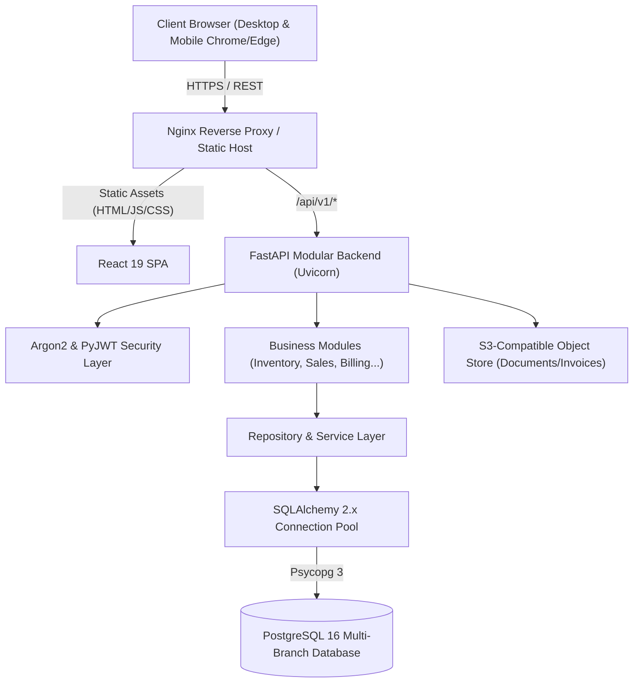

# Architecture Specification — AI Smart Bazar ERP

## 1. Executive Overview

**AI Smart Bazar** is an enterprise-grade ERP web application custom-built for **Siddeshwar Enterprises**. The application manages multi-branch retail, wholesale, inventory, financial accounting, procurement, logistics, and personnel operations.

### Core Architectural Paradigm: Modular Monolith
The application is structured as a **Modular Monolith**:
- Single unified deployable unit for both frontend and backend to eliminate unnecessary microservice distributed system complexities and latency overheads.
- Clear physical boundary decoupling between modules (each module encapsulating its own models, schemas, repositories, services, and routers).
- Centralized database with branch-level logical partitioning.
- Cloud-portable deployment profile (operable across AWS, GCP, Azure, or private cloud VMs).

---

## 2. Frontend Architectural Blueprint

### Core Technologies
- **UI Library**: React 18 / 19 with Vite.
- **Language**: TypeScript with strict mode enabled (`noImplicitAny`, `noUncheckedIndexedAccess`, `strictNullChecks`).
- **Styling**: Tailwind CSS with shadcn/ui design tokens and Radix UI accessible headless primitives.
- **State Segregation**:
  - *Server State*: TanStack Query v5 with automatic background refetching and caching.
  - *Client State*: Zustand (strictly restricted to global UI/Auth/Active Branch context).
- **Form Management**: React Hook Form coupled with Zod validation schemas.
- **Data Tables**: TanStack Table for headless pagination, sorting, and responsive column rendering.

### Desktop-First Responsive Layout
- **Large Screens (>= 1024px)**:
  - Persistent, collapsible sidebar with hierarchical navigation.
  - Sticky header featuring branch selector, notification hub, and user profile drawer.
  - Multi-column data layouts and advanced filter toolbars.
- **Mobile & Tablet Screens (< 1024px)**:
  - Touch-friendly hamburger drawer navigation.
  - Responsive table cards with horizontal scrolling prevention.
  - Full-width action sheets.

---

## 3. Backend Architectural Blueprint

### Layered Module Pattern
Every business domain module follows a strict 5-layer separation:
1. `router.py`: Declares HTTP endpoints, parameters, and dependency injections. **Zero business calculations permitted**.
2. `schemas.py`: Pydantic v2 input request and output response models enforcing strict type boundaries.
3. `models.py`: SQLAlchemy 2.x declarative entity definitions with multi-branch scoping mixins.
4. `repository.py`: Encapsulates all database queries, joins, and data access routines.
5. `service.py`: Orchestrates business workflows, validations, and database transaction scopes.

### Health Infrastructure
- `GET /api/v1/health`: Liveness probe reporting process uptime and version metadata.
- `GET /api/v1/health/database`: Readiness probe verifying PostgreSQL query execution round-trip latency without exposing credentials.

---

## 4. Multi-Tenant Scoping & Security

1. **Dual Scoping**: Every business record is tagged with `organization_id` and `branch_id`.
2. **Zero Storage in LocalStorage**: Access tokens are kept strictly in browser memory. Session persistence is managed through rotating `HttpOnly`, `Secure`, `SameSite=Lax` refresh cookies.
3. **Server-Side Authorization**: Branch headers passed by the client are always validated against user entitlements by FastAPI dependencies before executing any query.

