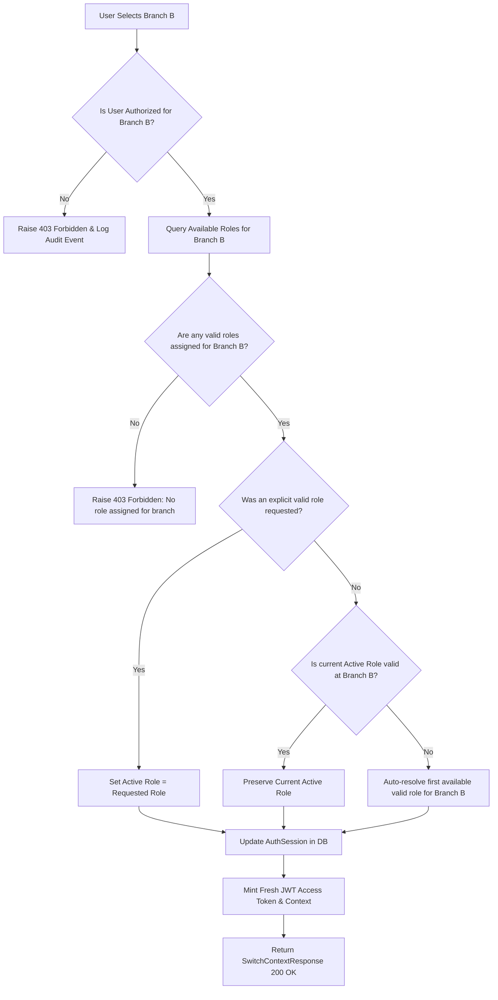

# AI Smart Bazar — Branch Context & Switching Architecture

**System**: AI Smart Bazar ERP  
**Client**: Siddeshwar Enterprises  
**Document**: Technical Design Specification — Branch Context & Multi-Store Data Isolation  
**Status**: APPROVED & IMPLEMENTED  

---

## 1. Multi-Branch Operating Model

Siddeshwar Enterprises operates multiple physical stores, wholesale depots, and logistics warehouses:
- **Headquarters (HQ)**: Corporate administration, consolidated billing, global catalog management.
- **Retail Outlets**: Fast POS, local counters, counter-specific cash drawers.
- **Warehouses**: Stock receipt (GRN), bulk inventory packaging, inter-branch logistics.

Data integrity mandates that transactions executed at Branch A do not accidentally pollute or reveal information belonging to Branch B, except when explicitly authorized for aggregated reporting.

---

## 2. Server-Side Branch Isolation Principles

### 2.1. Zero Trust of Frontend State
**A user MUST NOT access another branch by manually modifying frontend state, client storage, request query parameters, or HTTP headers.**

1. Every transactional request validates the tenant boundaries:
   - `organization_id` is extracted strictly from the validated JWT token/session context.
   - `branch_id` is extracted from the active session context or validated via `require_branch_context`.
2. The user's membership in the target branch is actively validated on the database:
   ```python
   def require_branch_context(
       request: Request,
       current_user: Annotated[AuthContext, Depends(get_current_user)],
       x_branch_id: str | None = Header(None, alias="X-Branch-ID"),
   ) -> str:
       branch_id = x_branch_id or current_user.active_branch_id or (current_user.allowed_branch_ids[0] if current_user.allowed_branch_ids else None)
       if not branch_id or not current_user.can_access_branch(branch_id):
           raise BranchAccessDeniedError(branch_id)
       return branch_id
   ```
3. If an unauthorized branch ID is submitted, the server raises `403 Forbidden` (`BranchAccessDeniedError`) and logs the attempt in `audit_logs`.

---

## 3. Dynamic Role Adaptation Across Branches

A user's available roles depend on the currently selected active branch:
- An **organization-wide role** (`branch_id IS NULL`) is available across *all* authorized branches.
- A **branch-scoped role** (`branch_id = target_branch_id`) is available *only* when the active branch matches that scope.



---

## 4. Branch Switching API Specification

### Endpoint: `POST /api/v1/auth/switch-branch`
- **Headers**: `Authorization: Bearer <access_token>`
- **Request Body**:
  ```json
  {
    "branch_id": "c1f10bc5-9833-4f91-8ad6-cb4b5b8d0001",
    "role_id": "d2f20cc6-1234-4f91-8ad6-cb4b5b8d0002" // optional
  }
  ```
- **Response**: `200 OK`
  ```json
  {
    "access_token": "eyJhbGciOiJIUzI1NiIsIn...",
    "token_type": "bearer",
    "context": {
      "user_id": "usr_998877",
      "organization_id": "org_siddeshwar",
      "active_branch_id": "c1f10bc5-9833-4f91-8ad6-cb4b5b8d0001",
      "active_branch_code": "PUN-RET",
      "active_branch_name": "Pune Retail Hub",
      "active_role_id": "d2f20cc6-1234-4f91-8ad6-cb4b5b8d0002",
      "active_role_name": "Cashier",
      "active_role_slug": "cashier",
      "available_branches": [...],
      "available_roles": [...],
      "effective_permissions": ["billing.invoice.create", "payments.payment.create"]
    }
  }
  ```

### Audit Trail
Executing a branch switch records an audit event in `audit_logs`:
- `action`: `BRANCH_SWITCH`
- `entity_type`: `AuthSession`
- `entity_id`: `<session_id>`
- `old_values`: `{"branch_id": "<old_id>", "role_id": "<old_role>"}`
- `new_values`: `{"branch_id": "<new_id>", "role_id": "<new_role>"}`
- `ip_address`: Telemetry IP.
- `user_agent`: Telemetry client agent string.
