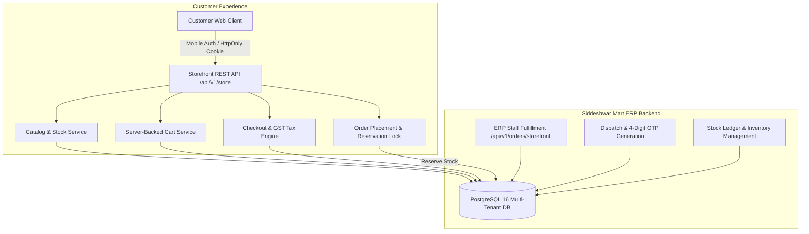

# Customer Commerce Architecture — AI Smart Bazar ERP

**Client:** Siddeshwar Enterprises  
**Module:** Customer Accounts, E-Commerce Storefront & Order Management  
**Status:** Production Ready  

---

## 1. Architectural Overview & Business Model

AI Smart Bazar's customer commerce architecture delivers an end-to-end retail grocery shopping experience seamlessly unified with Siddeshwar Enterprises' core ERP platform.

### Core Business Model Principles:
1. **Direct Mart Fulfillment:**
   - Customers place orders online directly with Siddeshwar Central Mart (and its branch fulfillment centers).
   - Shop employees assemble, pack, and verify orders.
   - Verified shop employees execute home delivery runs.
   - **Zero Third-Party Aggregator:** No external logistics partners (Zomato/Swiggy), avoiding marketplace fees and customer identity leakage.

2. **Strict Identity & RBAC Boundary:**
   - Customer accounts are granted `customer` system role template permissions (`customers.shop.view`, `customers.cart.manage`, `customers.order.create`, `customers.order.view`, `customers.profile.manage`).
   - Customer self-registration activates `approval_status="APPROVED"` for the storefront.
   - **Zero Employee Module Access:** Customers cannot access administrative endpoints (`/users`, `/roles`, `/billing/pos`, `/inventory`, `/accounting`, `/employees`). Attempts yield HTTP `403 Forbidden`.

---

## 2. System Components

### A. Customer Authentication & Identity Layer
- **Unified Identity Scope:** 10-digit Indian mobile number + bcrypt-hashed password.
- **Dual Session Mechanism:** 
  - Standard JWT `Bearer` token for API requests.
  - 30-day persistent `HttpOnly`, `SameSite=Lax`, `Secure` cookie (`customer_session_token`) preventing session fatigue and XSS exfiltration.
- **Auto-Provisioning:** Customer profile record (`Customer`) automatically linked to `User` via `user_id` foreign key.

### B. Product Catalog & Branch-Aware Inventory
- **Real-Time Visibility:** Products and variants display live stock counts (`available_stock`) filtered for the active branch fulfillment center.
- **Out-of-Stock Protections:** Zero or negative stock items are marked out-of-stock; adding to cart or order placement is rejected.
- **Categorization:** Hierarchical categories (e.g. Groceries & Daily Staples, Spices & Masalas, Oils & Ghee, Beverages).

### C. Server-Backed Persistent Shopping Cart
- **Data Model:** `Cart` (1-to-1 with `Customer`) and `CartItem` (referencing `ProductVariant`).
- **Real-Time Validation:** Cart recalculates totals, savings, and validates stock on every modification.
- **Cross-Session Persistence:** Carts survive browser restarts, tab closures, and device changes.

### D. Checkout, Taxes & Indian PIN Code Serviceability
- **Tax Calculation:** Strict Indian GST computation (CGST + SGST for intra-state Maharashtra, IGST for inter-state) driven by the product's tax category.
- **Delivery Fee Rules:** Configurable tiering (e.g., Free delivery above ₹499; flat ₹40 below ₹499).
- **Serviceability:** Validates Indian 6-digit postal PIN code format (`^[1-9][0-9]{5}$`) against serviced delivery zones.

### E. Fulfillment, Internal Dispatch & 4-Digit Delivery OTP
- **Employee Assignment:** Store manager assigns internal shop employee (`delivery_employee_id`) for doorstep delivery.
- **Secure Verification OTP:** Backend generates a random 4-digit numeric verification OTP (`delivery_otp`) visible only to the customer and the dispatch manager, verified before marking order as `DELIVERED`.

