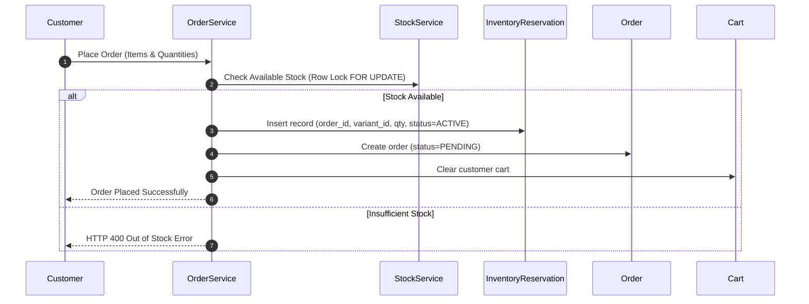

# Customer Inventory Integration — AI Smart Bazar ERP

**Client:** Siddeshwar Enterprises  
**Module:** Stock Reservation, Concurrency & Branch Isolation  
**Status:** Production Ready  

---

## 1. Inventory Model & Real-Time Availability

In a multi-branch retail mart, storefront inventory must reflect actual physical stock on shelves at the customer's fulfilling branch.

### Mathematical Stock Relationship:
$$\text{available\_stock} = \max\left(0, \text{physical\_quantity} - \sum \text{active\_reservations}\right)$$

Where:
- `physical_quantity`: Current ledger quantity recorded in `stock_ledger` / `InventoryItem`.
- `active_reservations`: Total quantity currently held under status `ACTIVE` in `InventoryReservation`.

---

## 2. Inventory Reservation Architecture

When a customer confirms checkout, stock is not directly decremented from physical storage immediately, because the order has not yet been picked from the shelf. Instead, an atomic reservation is created:

---

## 3. Concurrency Protection & Row-Level Locking

To eliminate race conditions when multiple customers order the final stock units concurrently:
- Stock checking uses PostgreSQL `SELECT ... FOR UPDATE` (or SQLAlchemy `with_for_update()`).
- Database constraints ensure `stock_quantity >= 0`.
- If two shoppers attempt to reserve the same unit simultaneously, one succeeds and the other receives an immediate clear notification of item unavailability.

---

## 4. Reservation Transitions

1. **Order Cancellation (Customer or Store Manager):**
   - Linked `InventoryReservation` rows transition to `CANCELLED`.
   - The reserved quantity is instantly returned to `available_stock`.
2. **Order Fulfillment (Delivered):**
   - The stock reservation status becomes `FULFILLED`.
   - An immutable movement entry is posted to `StockMovement` as `OUTWARD` dispatch.

