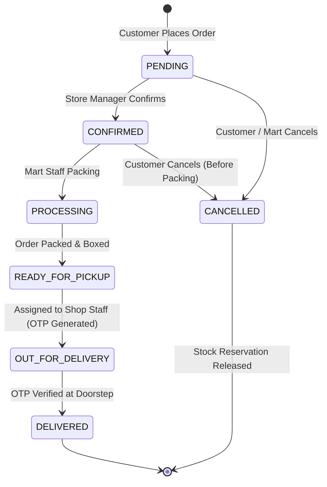

# Customer Order Lifecycle — AI Smart Bazar ERP

**Client:** Siddeshwar Enterprises  
**Module:** Order State Machine & Verification  
**Status:** Production Ready  

---

## 1. Complete Order State Machine

The order lifecycle reflects the real-world operational workflow of Siddeshwar Central Mart:

---

## 2. Order States & Transition Rules

| State | Initiator | Action Taken | Inventory Action |
|-------|-----------|--------------|------------------|
| `PENDING` | Customer | Order submitted from cart with chosen address & payment method | Creates active `InventoryReservation` for all items |
| `CONFIRMED` | Mart Staff | Store accepts order for fulfillment | Reservations maintained |
| `PROCESSING` / `PACKING` | Mart Staff | Assembly, picking, and bagging in the mart | Reservations maintained |
| `READY_FOR_PICKUP` | Mart Staff | Sealed bag ready at dispatch counter | Reservations maintained |
| `OUT_FOR_DELIVERY` | Dispatcher | Internal employee assigned (`delivery_employee_id`) | Generates secure 4-digit verification OTP (`delivery_otp`) |
| `DELIVERED` | Delivery Staff | Customer provides 4-digit OTP at doorstep | Finalizes stock deduction in ledger; marks reservation `FULFILLED` |
| `CANCELLED` | Customer / Staff | Customer cancels via app (allowed in `PENDING` / `CONFIRMED`) | Immediately releases `InventoryReservation` back to shelf |

---

## 3. Customer Order Cancellation Rules

Customers can cancel orders directly through the storefront interface under the following constraints:
1. **Permitted Statuses:** Only orders in `PENDING` or `CONFIRMED` status can be cancelled by the customer.
2. **Locked Statuses:** Once the mart staff begins packing (`PROCESSING`, `READY_FOR_PICKUP`, `OUT_FOR_DELIVERY`, or `DELIVERED`), customer cancellation is blocked (`HTTP 400 Bad Request`).
3. **Mandatory Reason:** A cancellation reason must be recorded in `cancellation_reason` and an immutable timeline entry appended to `order_timeline`.
4. **Instant Stock Release:** All linked `InventoryReservation` records are updated to `CANCELLED`, restoring the available inventory balance in real-time.

---

## 4. Internal Employee Delivery & Verification OTP

In accordance with Siddeshwar Enterprises' direct mart model:
- No third-party couriers are permitted.
- Internal employees handle delivery runs.
- To prevent doorstep disputes and ensure cash-on-delivery accountability, a 4-digit OTP is generated when assigned for delivery.
- The customer presents the OTP upon arrival, which confirms verified handover and marks the order as `DELIVERED`.

