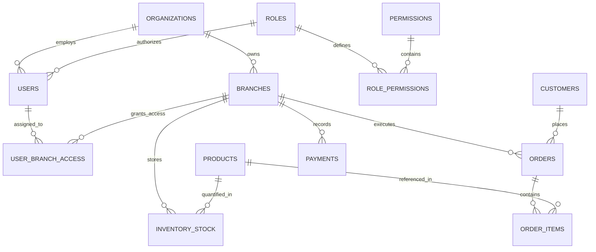

# Database Design Specification — AI Smart Bazar ERP

## 1. Relational Database Paradigm

- **Database Engine**: PostgreSQL 16+.
- **Driver**: Psycopg 3 (`psycopg[binary]`).
- **ORM**: SQLAlchemy 2.x with fully type-annotated `Mapped` attributes.
- **Migration Engine**: Alembic.

---

## 2. Core Entity Relationship Diagram (Multi-Branch Foundation)



---

## 3. Mandatory Scoping Attributes & Entity Mixins

All transactional business entities must inherit from `BranchScopedMixin` located in `app.database.base`:

```python
class BranchScopedMixin(OrganizationScopedMixin):
    organization_id: Mapped[str] = mapped_column(String(64), nullable=False, index=True)
    branch_id: Mapped[str] = mapped_column(String(64), nullable=False, index=True)
```

### Planned Database Tables for Upcoming Sprints

| Domain | Table Name | Purpose | Primary Keys & Scoping |
| :--- | :--- | :--- | :--- |
| **Organization** | `organizations` | Multi-tenant top-level enterprise record | `id`, `name`, `tax_id` |
| **Branches** | `branches` | Physical store & warehouse locations | `id`, `organization_id`, `code`, `name` |
| **Security** | `users` | Enterprise user credentials & profile | `id`, `organization_id`, `email`, `role_id` |
| **Security** | `user_branch_access` | Junction table for multi-branch user grants | `user_id`, `branch_id` |
| **Security** | `roles` | System and custom access roles | `id`, `organization_id`, `name` |
| **Security** | `permissions` | Granular action privileges | `id`, `code`, `module` |
| **Catalog** | `products` | Centralized master item catalog | `id`, `organization_id`, `sku`, `barcode` |
| **Inventory** | `inventory_stock` | Branch-specific stock quantities | `id`, `organization_id`, `branch_id`, `product_id` |
| **Sales** | `orders` | POS receipts and wholesale invoices | `id`, `organization_id`, `branch_id`, `order_number` |
| **Customers** | `customers` | Client records, credit ledgers | `id`, `organization_id`, `phone`, `name` |
| **Suppliers** | `suppliers` | Procurement vendor master records | `id`, `organization_id`, `name`, `gstin` |
| **Purchases** | `purchases` | Vendor POs and Goods Received Notes | `id`, `organization_id`, `branch_id`, `supplier_id` |
| **Finance** | `payments` | Customer collections & cash receipts | `id`, `organization_id`, `branch_id`, `amount` |
| **Audit** | `audit_logs` | Immutable audit trail | `id`, `organization_id`, `user_id`, `action`, `payload` |

---

## 4. Indexing & Partitioning Strategy

1. **Composite Tenant Indexes**: Every table queried by branch will maintain a composite index:
   ```sql
   CREATE INDEX ix_orders_org_branch_created ON orders (organization_id, branch_id, created_at DESC);
   ```
2. **Future Partitioning**: Highly write-intensive tables (`orders`, `audit_logs`) will support PostgreSQL native declarative range partitioning by `created_at` or list partitioning by `branch_id`.
