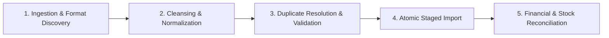

# Data Migration Plan — AI Smart Bazar ERP

## 1. Migration Overview

Siddeshwar Enterprises is transitioning from a legacy business management application. The format of the legacy data is currently unconfirmed and may arrive in multiple formats (Excel spreadsheets `.xlsx`, CSV files, legacy SQL dumps, or proprietary accounting exports).

This plan establishes a resilient, audited 5-stage data onboarding pipeline.

---

## 2. Five-Stage Migration Lifecycle

### Stage 1: Ingestion & Discovery
- Secure receipt of legacy data into isolated staging bucket.
- Detection of encoding (UTF-8, ISO-8859), column structures, and foreign key anomalies.
- Automated data profiling using `pandas` and `openpyxl`.

### Stage 2: Schema Mapping & Transformation
- Map legacy fields to AI Smart Bazar target schemas:
  - Product catalog (Name, SKU barcode, GST tax slabs, Cost price, Selling price).
  - Customer directory (Name, Phone number, Address, GSTIN, Opening balance).
  - Supplier directory (Vendor name, Contact details, Bank info).
  - Inventory opening stock (Branch allocation, batch number, current count).

### Stage 3: Duplicate Resolution & Fuzzy Matching
- Run customer identity resolution on phone numbers and address fuzzy matching to prevent duplicate customer profiles.
- Flag conflicting SKU numbers or missing GST rates for administrative review.

### Stage 4: Atomic Batch Ingestion
- Ingest data in transactional chunks (500 records per transaction).
- Apply rollback triggers upon foreign key integrity failures.
- Record every imported entity in `audit_logs` tagged with `source: legacy_migration`.

### Stage 5: Financial & Inventory Reconciliation
- Verify that total customer opening balances match legacy accounting balance sheet totals.
- Verify that opening stock valuation matches physical inventory audit tallies.
- Client stakeholder sign-off prior to production go-live.
