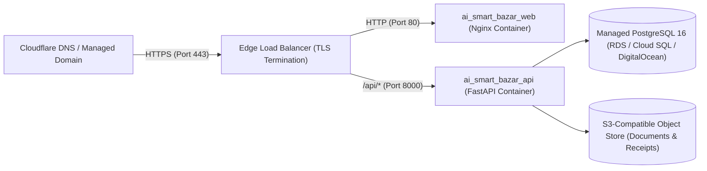

# Production Deployment Specification — AI Smart Bazar ERP

## 1. Cloud-Agnostic Hosting Architecture

To adhere to the requirement of portable cloud hosting without vendor lock-in, the system builds into standardized, self-contained OCI container images.



---

## 2. Target Deployment Profiles

### Option A: Cloud Container Run (Google Cloud Run / AWS ECS Fargate)
- Fully managed serverless containers.
- Autoscaling from 1 instance up to peak requirements.
- Zero server maintenance overhead.

### Option B: High-Availability VM Cluster (Linux + Docker Compose)
- Single or clustered Linux instances (Ubuntu 24.04 LTS).
- Ingress managed by Nginx with automated Let's Encrypt SSL certificates.
- Internal bridge network with localhost-bound PostgreSQL.

---

## 3. Environment Variable Injection Strategy

All production secrets must be supplied at runtime by the container orchestrator (e.g., AWS Secrets Manager, GCP Secret Manager, or GitHub Secrets):

| Variable | Requirement | Description |
| :--- | :--- | :--- |
| `DATABASE_URL` | Mandatory | Production PostgreSQL connection URL with SSL mode |
| `SECRET_KEY` | Mandatory | Minimum 64-character cryptographically random string |
| `JWT_ALGORITHM` | Mandatory | `HS256` or `RS256` |
| `CORS_ORIGINS` | Mandatory | Fully qualified production frontend domains |
| `COOKIE_SECURE` | Mandatory | Set to `true` (enforces HTTPS cookie transmission) |
| `STORAGE_BACKEND` | Optional | `s3` for cloud object storage |
| `S3_ENDPOINT_URL` | Optional | Custom MinIO / Cloudflare R2 endpoint if applicable |

---

## 4. Zero Downtime Database Migrations

During continuous deployment pipelines:
1. Run pre-deploy migration step:
   ```bash
   alembic upgrade head
   ```
2. Verify database health probe returns HTTP 200.
3. Deploy new backend container images using rolling deployment.
4. Promote traffic to new release.
