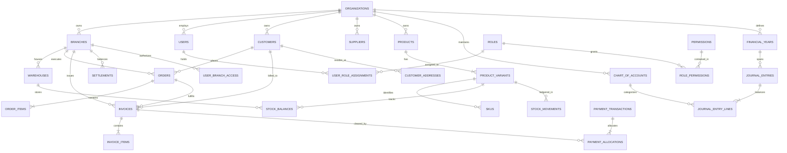

# AI Smart Bazar ERP — Entity Relationship Architecture

The diagram below illustrates the core foundational entities and foreign key relationships connecting Tenancy, RBAC, Catalog, Inventory, Sales, Billing, Payments, and Accounting.

### Critical Relationship Boundaries

1. **Organization Isolation Barrier**:
   Entities like `customers`, `products`, `suppliers`, and `roles` belong strictly to an `organization_id`. Cross-tenant queries are blocked at both database constraint and application repository layers.
2. **Branch Operational Autonomy**:
   `branches` maintain their own `stock_balances`, `invoice_sequences`, `settlements`, and local staff access (`user_branch_access`).
3. **Double-Entry Ledger Integrity**:
   `journal_entry_lines` are tied directly to `chart_of_accounts`, guaranteeing that any balance movement maps to a recognized ledger account.
