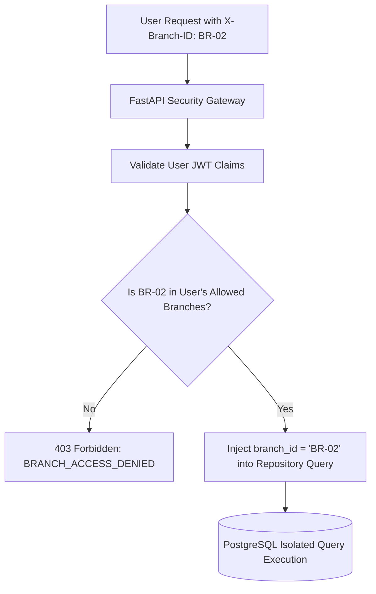

# Multi-Branch & Multi-Tenant Architecture — AI Smart Bazar ERP

## 1. Multi-Branch Isolation Model

Siddeshwar Enterprises operates multiple physical stores, warehouses, and fulfillment points.

### Absolute Rule: Never a Single-Branch Architecture
A core design requirement is that every business record is isolated by both `organization_id` and `branch_id`.

---

## 2. Multi-Branch Access Patterns

1. **Single-Branch User**: A cashier or store clerk stationed exclusively at one branch. Their JWT claims include only `allowed_branches: ["br_pune_south"]`. Requests attempting to supply any other branch ID are rejected with `403 BRANCH_ACCESS_DENIED`.
2. **Multi-Branch User**: Area managers or senior inventory auditors authorized across multiple regional stores (e.g. `allowed_branches: ["br_hq", "br_south", "br_warehouse_01"]`). The frontend branch selector allows toggling the active operational branch, sending `X-Branch-ID`.
3. **Organization-Level User**: Organization Executives and Super Administrators. They have global visibility across all branches and can query consolidated organization-wide reports without individual branch filters.

---

## 3. Data Isolation Guarantees

- **No Client Trust**: Frontend branch selection is purely for UI context. The backend FastAPI layer **always** validates branch access before querying or mutating data.
- **Cross-Branch Stock Transfers**: Controlled through a dedicated two-step ledger workflow:
  1. Source branch issues a `stock_transfer_out` transaction (deducting source warehouse stock).
  2. Destination branch verifies delivery and signs off `stock_transfer_in` (incrementing destination stock).
