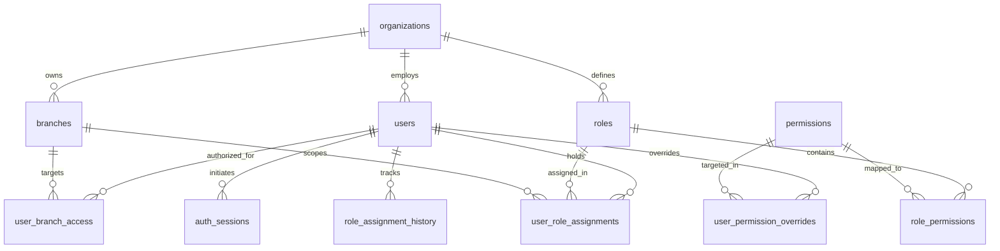

# AI Smart Bazar — Multi-Role Architecture

**System**: AI Smart Bazar ERP  
**Client**: Siddeshwar Enterprises  
**Document**: Architecture Design Document — Multi-Role & User Identity  
**Status**: APPROVED & IMPLEMENTED  

---

## 1. Executive Summary & Identity Philosophy

In enterprise retail and distribution operations like Siddeshwar Enterprises, employees frequently hold diverse responsibilities across distinct physical stores, warehouses, and headquarters. For example:
- A senior employee may act as **Headquarters Accountant** on weekdays and as a **Branch Cashier / Supervisor** on weekends.
- An area manager may supervise operations across three regional retail outlets while retaining corporate compliance privileges.

Traditional legacy systems often clone user accounts per role (e.g., `amar_accountant` vs `amar_cashier`). This creates severe security vulnerabilities:
1. Fragmented identity trails and uncoordinated password resets.
2. Stale or orphaned credentials when employees transition roles.
3. Lack of unified audit logging across operations.

**AI Smart Bazar strictly enforces a Unified User Identity Model**:
- Exactly **one user account** per employee.
- Authentication is anchored by **Mobile Number** (or corporate email) and Argon2id password.
- A single identity can hold multiple organization memberships, multiple branch authorizations, and multiple role assignments.
- Roles are strictly scoped, time-bounded, and evaluated in isolation based on the user's active session selection.

---

## 2. Entity Relational Architecture

The architecture decouples identity (`users`) from access credentials (`roles`), physical locations (`branches`), and active sessions (`auth_sessions`).



---

## 3. Core Database Entities & Field Specifications

### 3.1. User Identity (`users`)
- `id` (UUID PK): Global user identifier.
- `organization_id` (UUID FK -> `organizations.id`): Primary organization.
- `phone` (VARCHAR(50), indexed): Primary login identifier for mobile-first operational authentication. Indexed via `ix_user_phone` and `ix_user_org_phone`.
- `email` (VARCHAR(255), indexed): Corporate email.
- `password_hash` (VARCHAR(255)): Argon2id password hash.
- `full_name` (VARCHAR(150)): Employee legal full name.
- `is_active` (BOOLEAN): Master kill-switch. When `False`, all active sessions and authentications are blocked immediately.
- `is_verified` (BOOLEAN): Mobile/email OTP verification status.

### 3.2. Role Assignment (`user_role_assignments`)
Tracks the relationship between a user, a role, an organization, and an optional branch scope.
- `id` (UUID PK)
- `user_id` (UUID FK -> `users.id`)
- `role_id` (UUID FK -> `roles.id`)
- `organization_id` (UUID FK -> `organizations.id`)
- `branch_id` (UUID FK -> `branches.id`, nullable):
  - `NULL`: **Organization-Wide Scope**. The role is active across all branches in the organization (e.g., General Manager, Corporate Auditor).
  - `<UUID>`: **Branch-Scoped**. The role is valid *only* when the user is operating within that specific branch (e.g., Cashier at Pune Retail Outlet).
- `assigned_by` (UUID FK -> `users.id`): Administrator who granted the role.
- `assigned_at` (TIMESTAMPTZ): UTC timestamp of grant.
- `valid_from` (TIMESTAMPTZ, nullable): Effective start timestamp.
- `valid_until` (TIMESTAMPTZ, nullable): Expiration timestamp. Automatic time-bounding for contractors, temporary supervisors, or holiday staffing.
- `is_active` (BOOLEAN): Administrative toggle without revoking historical record.
- `status` (VARCHAR(30)): State machine value: `ACTIVE`, `INACTIVE`, `REVOKED`, `EXPIRED`.
- `revoked_at` (TIMESTAMPTZ, nullable): Timestamp of revocation.
- `revoked_by` (UUID FK -> `users.id`, nullable): Administrator executing revocation.
- `notes` (TEXT, nullable): Audit rationale for assignment or changes.

**Unique Constraint**: `uq_user_role_scope` on `(user_id, role_id, organization_id, branch_id)` prevents duplicate assignment records for the identical scope.

### 3.3. Role Assignment History Ledger (`role_assignment_history`)
An append-only, immutable audit ledger capturing every lifecycle transition of an assignment:
- `id` (UUID PK)
- `assignment_id` (UUID): Reference to the assignment.
- `user_id` (UUID FK -> `users.id`)
- `role_id` (UUID FK -> `roles.id`)
- `organization_id` (UUID FK -> `organizations.id`)
- `branch_id` (UUID FK -> `branches.id`, nullable)
- `action` (VARCHAR(50)): `ASSIGNED`, `ACTIVATED`, `DEACTIVATED`, `REVOKED`, `MODIFIED`.
- `performed_by` (UUID FK -> `users.id`): Identity executing the change.
- `details` (JSONB): Delta changes, previous states, validity dates, or revocation reasons.
- `notes` (TEXT, nullable)
- `created_at` (TIMESTAMPTZ): Clock-monotonic UTC timestamp.

### 3.4. Branch Access Authorization (`user_branch_access`)
Explicit authorization grant allowing a user to access a specific physical branch.
- `id` (UUID PK)
- `user_id` (UUID FK -> `users.id`)
- `branch_id` (UUID FK -> `branches.id`)
- `is_default` (BOOLEAN): Default branch selected upon fresh authentication.
- `is_active` (BOOLEAN): Master toggle for branch physical access.
- `assigned_by` (UUID, nullable): Administrator who granted access.

---

## 4. Administrative Security Guards & Non-Self-Modification

To enforce segregation of duties and prevent privilege escalation:
1. **Self-Modification Guard**: An employee or administrator can **NEVER** modify their own roles, active status, branch access, or permission overrides. The backend strictly evaluates:
   ```python
   if user_id == current_user_id:
       raise HTTPException(400, "Security policy violation: Employees cannot modify their own permissions or roles")
   ```
2. **Cross-Organization Boundary Enforcement**: Roles belonging to Organization A (`role.organization_id == org_A`) cannot be assigned to users in Organization B (`user.organization_id == org_B`). Any cross-tenant attempt raises a 400 Bad Request and logs an audit security event.
3. **Mid-Session Revocation Guard**: When an administrator revokes a role or deactivates an assignment, existing bearer tokens for that role are rejected on their next API call via database session validation.

