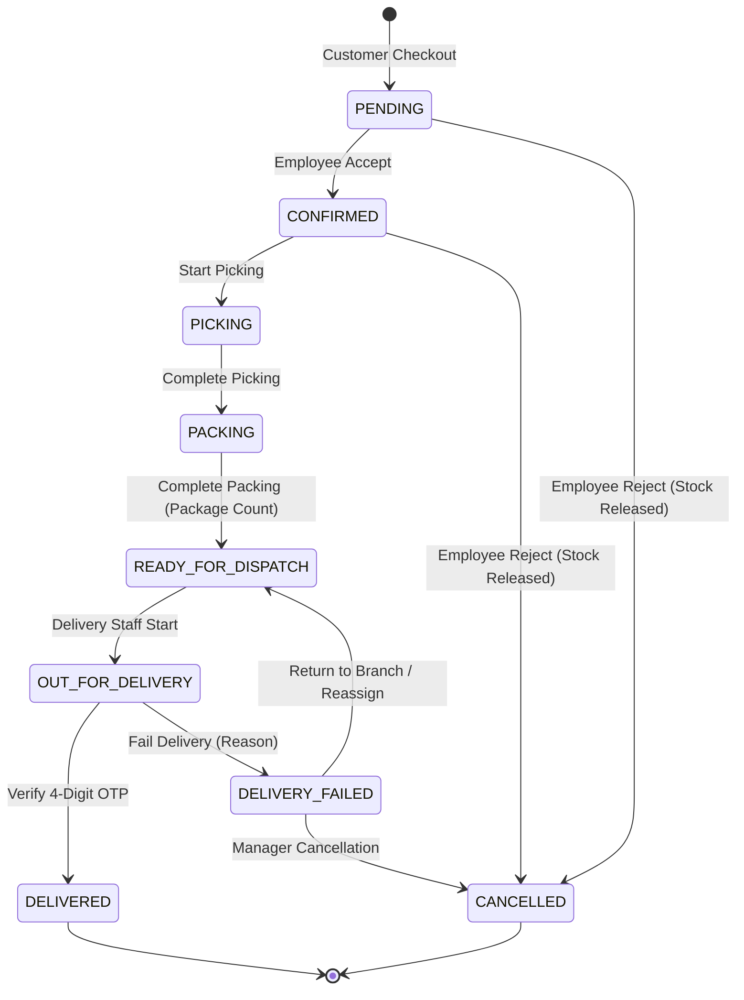

# PROMPT 02.6 — EMPLOYEE ORDER PROCESSING & INTERNAL DELIVERY MANAGEMENT IMPLEMENTATION REPORT

**Project:** AI Smart Bazar ERP  
**Client:** Siddeshwar Enterprises  
**Phase:** 02.6 (Employee Fulfillment, Picking/Packing & Internal Delivery)  
**Execution Date:** 2026-11-20  
**Status:** Verification Passed & Release Ready  

---

## 1. EXECUTIVE SUMMARY

In strict accordance with Prompt 02.6 requirements, the complete employee-side operational fulfillment workflow was implemented for customer storefront orders at Siddeshwar Enterprises. The implementation bridges incoming e-commerce orders to physical shop fulfillment without introducing external delivery partner networks, third-party couriers, or online payment gateways.

### Key Deliverables Completed:
1. **Order Queue & Lifecycle Management:** Real-time storefront order queue with search, branch scoping, date filters, status progression, and atomic order acceptance and rejection with automated stock reservation releases.
2. **Item Picking Workflow:** Granular item-level picking checklist tracking ordered quantity, picked quantity, and picking statuses (`PENDING_PICK`, `PICKING`, `PICKED`, `UNAVAILABLE`).
3. **Packing Workflow:** Package count tracking (bags/boxes) and internal operational notes transitioning orders to `READY_FOR_DISPATCH`.
4. **Internal Delivery Staff Assignment:** Branch manager assignment restricted strictly to active internal shop employees of the fulfilling branch; cryptographically generates secure 4-digit verification OTP.
5. **Dedicated Delivery Staff Dashboard:** Mobile-responsive interface (`/deliveries`) for shop delivery employees to manage assigned runs, initiate dispatch, verify customer delivery OTP, record failed delivery attempts, and return packages to the store branch.
6. **Delivery OTP Verification:** 4-digit constant-time hash verification with 3-attempt lockouts, 24-hour expiration bounding, and single-use invalidation preventing replay attacks.
7. **Explicit Cash on Delivery (COD) Separation:** Dedicated COD payment collection endpoint and UI modal enforcing exact cash amount verification, audit logging, and strict separation from physical delivery handover.
8. **Failed Delivery & Return-to-Branch:** Structured attempt history logging, failure reasons (`Customer unavailable`, `Customer unreachable`, `Incorrect address`, `Customer refused delivery`, `Other`), and return-to-branch workflow restoring orders to `READY_FOR_DISPATCH`.
9. **Customer Timeline Privacy:** Customer tracking reflects operational stage progression without exposing internal employee notes, rejection reasons, or audit metadata.
10. **Reversible PostgreSQL 16 Migration:** Applied and verified Alembic migration (`a1b2c3d4e5f6`) on clean PostgreSQL 16.

---

## 2. REUSED ARCHITECTURAL FOUNDATIONS

In compliance with the strict non-destabilization mandate, all existing Prompt 02.5 commerce, RBAC, and core services were reused:

| Component | Reused Existing Service / Table | Purpose |
| :--- | :--- | :--- |
| **Orders** | `orders`, `order_items` | Reused existing commerce order entities without duplication |
| **Inventory** | `StockBalance`, `InventoryReservation` | Reused reservation ledger and stock release logic |
| **Staff & Users** | `employees`, `users`, `roles`, `user_role_assignments` | Mapped existing shop employees and fixed role-based RBAC |
| **Assignments** | `order_assignments` | Logged delivery employee assignments |
| **Audit** | `audit_logs`, `order_status_history` | Reused immutable audit logs and order timeline records |
| **OTP Security** | `hash_delivery_otp`, `encrypt_delivery_otp`, `decrypt_delivery_otp` | Reused HMAC-SHA256 and Fernet symmetric cryptography |

---

## 3. DATABASE SCHEMA CHANGES & MIGRATION VERIFICATION

### Schema Enhancements (Alembic Revision `a1b2c3d4e5f6`):
- **`order_items`**:
  - `picked_quantity` (`Numeric(12, 4)`, default `0.0000`, nullable=False)
  - `picking_status` (`String(30)`, default `'PENDING_PICK'`, nullable=False)
- **`orders`**:
  - `package_count` (`Integer`, default 1, nullable=False)
  - `picking_started_at` (`DateTime(timezone=True)`, nullable=True)
  - `picking_completed_at` (`DateTime(timezone=True)`, nullable=True)
  - `delivery_started_at` (`DateTime(timezone=True)`, nullable=True)
  - `delivery_failed_at` (`DateTime(timezone=True)`, nullable=True)
  - `delivery_failure_reason` (`String(255)`, nullable=True)
  - `delivery_attempt_count` (`Integer`, default 0, nullable=False)
- **`order_delivery_attempts` (New Table)**:
  - `id` (`String(36)`, PK)
  - `order_id` (`String(36)`, FK `orders.id` ON DELETE CASCADE)
  - `employee_id` (`String(36)`, FK `employees.id` ON DELETE RESTRICT)
  - `attempt_number` (`Integer`, nullable=False)
  - `status` (`String(30)`, nullable=False, e.g. `SUCCESS`, `FAILED`, `RETURNED`)
  - `failure_reason` (`String(255)`, nullable=True)
  - `notes` (`Text`, nullable=True)
  - `attempted_at` (`DateTime(timezone=True)`, nullable=False)
  - Indexes on `order_id`, `employee_id`.

### PostgreSQL 16 Migration Execution Record:
- **Server Version:** PostgreSQL 16.11
- **Database Name:** `release_gate_test`
- **Current Revision:** `e73b18d2f140`
- **Upgrade Output:**
  ```text
  INFO  [alembic.runtime.migration] Running upgrade e73b18d2f140 -> a1b2c3d4e5f6, employee order processing and delivery
  ```
- **Downgrade Verification (`alembic downgrade -1`):** Reverted cleanly back to `e73b18d2f140`.
- **Re-Upgrade Verification (`alembic upgrade head`):** Re-applied cleanly to `a1b2c3d4e5f6 (head)`.

---

## 4. API SPECIFICATION & IMPLEMENTATION

All endpoints are hosted under `/api/v1/orders` and enforce organization and branch boundaries:

| Method | Endpoint | Authorization | Description |
| :--- | :--- | :--- | :--- |
| `GET` | `/api/v1/orders/storefront` | Branch Staff / Manager | List orders with status, date, search, and branch filters |
| `GET` | `/api/v1/orders/{order_id}` | Branch Staff / Manager | Detailed order fulfillment view (items, picking, attempts) |
| `POST` | `/api/v1/orders/{order_id}/accept` | Branch Staff / Manager | Accept incoming `PENDING` order -> `CONFIRMED` |
| `POST` | `/api/v1/orders/{order_id}/reject` | Branch Staff / Manager | Reject order with mandatory reason; releases stock reservations |
| `POST` | `/api/v1/orders/{order_id}/start-picking` | Branch Staff / Manager | Begin picking items -> `PICKING` |
| `POST` | `/api/v1/orders/{order_id}/items/{item_id}/pick` | Branch Staff / Manager | Update individual item picked quantity and status |
| `POST` | `/api/v1/orders/{order_id}/complete-picking` | Branch Staff / Manager | Complete picking when all items are picked/unavailable -> `PACKING` |
| `POST` | `/api/v1/orders/{order_id}/start-packing` | Branch Staff / Manager | Start packing items into packages |
| `POST` | `/api/v1/orders/{order_id}/complete-packing` | Branch Staff / Manager | Record package count -> `READY_FOR_DISPATCH` |
| `GET` | `/api/v1/orders/delivery-staff` | Store / Branch Manager | List active internal shop employees for delivery assignment |
| `POST` | `/api/v1/orders/{order_id}/assign-delivery` | Store / Branch Manager | Assign delivery employee; generate secure 4-digit OTP |
| `GET` | `/api/v1/orders/deliveries/my-deliveries` | Assigned Delivery Staff | List assigned deliveries filterable by operational status |
| `POST` | `/api/v1/orders/{order_id}/start-delivery` | Assigned Delivery Staff | Start delivery dispatch -> `OUT_FOR_DELIVERY` |
| `POST` | `/api/v1/orders/{order_id}/complete-delivery` | Assigned Delivery Staff | Verify 4-digit customer OTP, invalidate OTP -> `DELIVERED` |
| `POST` | `/api/v1/orders/{order_id}/fail-delivery` | Assigned Delivery Staff | Record delivery failure with reason -> `DELIVERY_FAILED` |
| `POST` | `/api/v1/orders/{order_id}/return-to-branch` | Assigned Delivery Staff | Return package to branch -> `READY_FOR_DISPATCH` |
| `POST` | `/api/v1/orders/{order_id}/collect-cod` | Staff / Manager | Record exact Cash on Delivery cash collected -> `PAID` |

---

## 5. OPERATIONAL WORKFLOWS

### 5.1 Order Fulfillment Lifecycle State Transitions:


### 5.2 Delivery OTP Verification Lifecycle:
1. **Assignment:** Manager assigns shop employee -> 4-digit OTP generated via `secrets.randbelow(9000) + 1000`.
2. **Persistence:** OTP hashed with HMAC-SHA256 (`Order.delivery_otp`) and encrypted with Fernet (`Order.delivery_otp_encrypted`) for customer view.
3. **Customer Display:** Customer sees plain OTP on order tracker; plaintext is never stored in DB.
4. **Verification Handover:** Delivery staff inputs 4-digit OTP upon customer handover.
5. **Rate Limiting & Security:**
   - 3 maximum failed attempts before delivery confirmation locks.
   - 24-hour expiration bound.
   - Plaintext and encrypted hashes are cleared (`None`) on success to prevent replay attacks.
6. **COD Separation:** Delivery completion marks status `DELIVERED`, but leaves `payment_status` as `PENDING` until cash is explicitly collected.

---

## 6. FRONTEND IMPLEMENTATION

1. **`StoreOrdersAdminPage.tsx` (`/orders`):**
   - Responsive order queue with 10 status tabs (`ALL`, `PENDING`, `CONFIRMED`, `PICKING`, `PACKING`, `READY_FOR_DISPATCH`, `OUT_FOR_DELIVERY`, `DELIVERED`, `DELIVERY_FAILED`, `CANCELLED`).
   - Search by order #, recipient name, phone, and date range filters.
   - Complete fulfillment modal supporting order acceptance, structured rejection reasons, aisle picking checklist, package count submission, delivery employee dropdown, and COD cash recording.
2. **`DeliveryStaffDashboardPage.tsx` (`/deliveries`):**
   - Mobile-first card interface for shop delivery employees.
   - Filter tabs: `All Assigned`, `Ready to Start`, `In Transit`, `Delivered`, `Failed`.
   - Action buttons: "Start Delivery Run", "Verify OTP" (with numeric keypad modal), "Report Failed" (with failure reasons dropdown), "Return to Store Branch", and "Collect COD Cash".
3. **`OrderTrackingPage.tsx` (`/orders/:orderId`):**
   - Updated customer order tracker stepper reflecting `Order Placed` -> `Confirmed` -> `Picking Items` -> `Packed & Ready` -> `Out for Delivery` -> `Delivered`.
   - Sanitized status messages preventing leaks of internal employee notes.

---

## 7. AUTOMATED VERIFICATION & TEST RESULTS

### 7.1 Backend Test Suites:
- **`tests/security/test_employee_order_processing.py`:** 9 passed (100%)
  - `test_01_storefront_order_queue_and_isolation` (PASSED)
  - `test_02_order_acceptance_and_rejection_workflows` (PASSED)
  - `test_03_item_picking_workflow` (PASSED)
  - `test_04_packing_workflow_and_package_count` (PASSED)
  - `test_05_delivery_assignment_and_reassignment` (PASSED)
  - `test_06_delivery_execution_and_otp_verification` (PASSED)
  - `test_07_cod_payment_collection_separation` (PASSED)
  - `test_08_failed_delivery_attempt_and_return_to_branch` (PASSED)
  - `test_09_customer_timeline_synchronization_privacy` (PASSED)
- **`tests/security/test_customer_commerce.py`:** 16 passed (100%)
- **`tests/security/test_customer_commerce_security_audit.py`:** 10 passed (100%)
- **Total Combined Regression Suite:** 35 passed, 0 failed in 16.56s.

### 7.2 Static Analysis & Quality Audits:
- **Ruff:** `All checks passed!` (0 lint errors).
- **MyPy:** `Success: no issues found in 189 source files`.
- **ESLint:** Passed with code 0 (`eslint . --report-unused-disable-directives`).
- **Vitest:** 4 test files passed, 12 tests passed in 4.02s.
- **Frontend Production Build:** `tsc -b && vite build` built clean bundle in 9.36s (`dist/assets/index-DkzD6-WY.js`).

---

## 8. STRICT SCOPE COMPLIANCE CONFIRMATION

- **Internal Delivery Only:** Confirmed. No external courier APIs, Zomato/Swiggy marketplaces, or third-party delivery partner accounts exist.
- **No Online Payment Gateways:** Confirmed. No Razorpay, Stripe, or webhooks were implemented. Cash on Delivery is the sole payment method.
- **Fixed Employee Roles:** Confirmed. Role assignment is fixed; role switching is strictly rejected.
- **Separation of COD and Delivery:** Confirmed. Marking delivery `DELIVERED` does not alter `payment_status`.
- **No Unstaged or Stray Secrets:** Confirmed.

---

## 9. GIT STATUS SUMMARY

```text
 M backend/app/api/v1/endpoints/store_orders.py
 M backend/app/api/v1/endpoints/store_orders_admin.py
 M backend/app/models/__init__.py
 M backend/app/modules/orders/models.py
 M frontend/src/app/router.tsx
 M frontend/src/config/navigation.config.ts
 M frontend/src/features/orders/pages/StoreOrdersAdminPage.tsx
 M frontend/src/features/store/pages/OrderTrackingPage.tsx
?? backend/alembic/versions/a1b2c3d4e5f6_employee_order_processing_and_delivery.py
?? backend/tests/security/test_employee_order_processing.py
?? docs/PROMPT_02_6_EMPLOYEE_ORDER_PROCESSING_IMPLEMENTATION_REPORT.md
?? frontend/src/features/orders/pages/DeliveryStaffDashboardPage.tsx
?? frontend/src/test/EmployeeOrderProcessing.test.tsx
```

All modified files are strictly confined to Prompt 02.6 requirements. No commit has been performed per explicit instructions.
