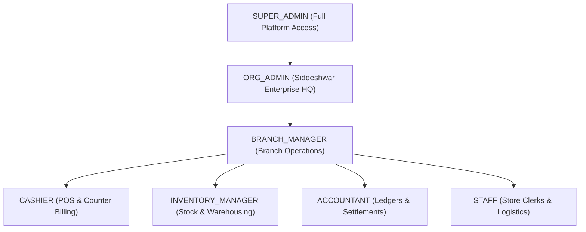

# Role-Based Access Control (RBAC) Specification — AI Smart Bazar ERP

## 1. Security Architecture Principles

1. **Principle of Least Privilege**: Users are granted only the permissions essential to perform their daily duties.
2. **Server-Side Enforcement**: All permissions are strictly validated in FastAPI dependency injections before repository access. Frontend guards only control UI visibility.
3. **Multi-Role Scoping**: System accounts are assigned a predefined or custom role, linked with one or more authorized branches.

---

## 2. Standard Role Hierarchy



---

## 3. Permissions Matrix

| Permission Code | Description | Super Admin | Org Admin | Branch Manager | Cashier | Inventory Mgr | Accountant |
| :--- | :--- | :---: | :---: | :---: | :---: | :---: | :---: |
| `*` | Full system bypass | ✅ | ❌ | ❌ | ❌ | ❌ | ❌ |
| `org:manage` | Edit organization profile | ✅ | ✅ | ❌ | ❌ | ❌ | ❌ |
| `branch:manage` | Create / modify branches | ✅ | ✅ | ❌ | ❌ | ❌ | ❌ |
| `users:manage` | Invite & assign users | ✅ | ✅ | ⚠️ (branch) | ❌ | ❌ | ❌ |
| `products:write`| Add / edit catalog items | ✅ | ✅ | ✅ | ❌ | ✅ | ❌ |
| `inventory:write`| Stock adjustment / transfer | ✅ | ✅ | ✅ | ❌ | ✅ | ❌ |
| `billing:create`| Issue POS customer receipt | ✅ | ✅ | ✅ | ✅ | ❌ | ❌ |
| `billing:cancel`| Void / refund transaction | ✅ | ✅ | ✅ | ❌ | ❌ | ❌ |
| `accounts:read` | View GL & profit reports | ✅ | ✅ | ✅ | ❌ | ❌ | ✅ |
| `audit:view` | Inspect audit trail logs | ✅ | ✅ | ❌ | ❌ | ❌ | ❌ |

---

## 4. Backend Permission Verification Pattern

```python
@router.post("/products", dependencies=[Depends(require_permission("products:write"))])
async def create_product(
    payload: ProductCreateSchema,
    branch_id: str = Depends(require_branch_context),
    db: Session = Depends(get_db),
):
    # Endpoint execution proceeds only after RBAC & Branch validation
    ...
```

