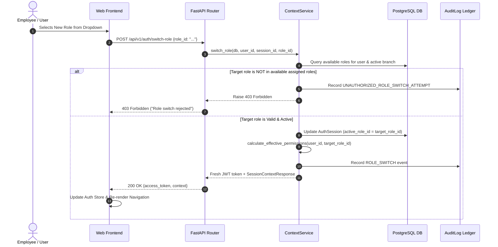

# AI Smart Bazar — Role Switching & Permission Evaluation Design

**System**: AI Smart Bazar ERP  
**Client**: Siddeshwar Enterprises  
**Document**: Technical Design Specification — Role Switching & Dynamic Permission Matrix  
**Status**: APPROVED & IMPLEMENTED  

---

## 1. Role Switching Workflow Overview

AI Smart Bazar enables authorized users who hold multiple assigned roles to switch their active working context smoothly and instantaneously without logging out or re-entering credentials.

### 1.1. Core Requirements
1. **Zero Re-Authentication**: Switching takes place in under 50 milliseconds via a single REST API call.
2. **Server-Side Validation**: The backend rigorously verifies that the target role is actively assigned to the user, valid for the current branch scope, within valid date bounds, and not revoked.
3. **Permission Recalculation**: Permissions are recalculated strictly for the selected active role.
4. **Token Minting & Session Binding**: The persistent database `AuthSession` is updated, and a fresh JWT access token containing the updated claims is minted and returned.
5. **Security Audit**: Both successful role switches and unauthorized switch attempts are permanently recorded in the immutable `audit_logs` table.



---

## 2. Mathematical Permission Evaluation Model

### 2.1. The Isolation Principle
**Permissions from multiple assigned roles are NEVER combined automatically.**

If an employee has both:
- **Role A**: `Accountant` (Permissions: `accounts.*`, `billing.invoice.view`)
- **Role B**: `Cashier` (Permissions: `billing.invoice.create`, `payments.payment.create`)

When the user is operating in the `Cashier` context, they do **NOT** have access to `accounts.*`. They operate with the least-privilege boundary appropriate to their active functional role.

### 2.2. The Effective Permission Formula
$$\text{Effective Permissions} = (\mathcal{P}_{\text{active\_role}} \cup \mathcal{E}_{\text{grants}}) \setminus \mathcal{E}_{\text{denials}}$$

Where:
- $\mathcal{P}_{\text{active\_role}}$: The set of permission codes associated with the selected active role in `role_permissions`.
- $\mathcal{E}_{\text{grants}}$: User-specific explicit permission grants stored in `user_permission_overrides` with `is_granted = True`.
- $\mathcal{E}_{\text{denials}}$: User-specific explicit permission denials stored in `user_permission_overrides` with `is_granted = False`.

### 2.3. Super-Admin & Wildcard Resolution
- If $\mathcal{P}_{\text{active\_role}}$ contains the wildcard `*`, the user has full system access **unless** an explicit denial exists in $\mathcal{E}_{\text{denials}}$ for a specific submodule.
- For non-wildcard roles, permissions are resolved strictly on a match-by-match basis.

---

## 3. Session Context State Tracking

The authenticated session state is dual-anchored:
1. **Stateless JWT Access Token (Client-Side Bearer)**:
   ```json
   {
     "sub": "usr_998877",
     "session_id": "ses_554433",
     "organization_id": "org_siddeshwar",
     "active_branch_id": "br_pune_hq",
     "role_id": "rol_cashier",
     "role": "cashier",
     "permissions": ["billing.invoice.create", "payments.payment.create"],
     "allowed_branches": ["br_pune_hq", "br_pune_retail"],
     "exp": 1740000000
   }
   ```
2. **Stateful Database Session (`auth_sessions`)**:
   - `id`: Unique session identifier (`session_id`).
   - `user_id`: Owning user.
   - `active_branch_id`: Currently bound branch.
   - `active_role_id`: Currently bound role.
   - `status`: `ACTIVE`, `INACTIVE`, `REVOKED`.
   - `is_revoked`: Fast boolean flag.
   - `ip_address`, `user_agent`: Device telemetry.

### 3.1. Immediate Mid-Session Revocation
Whenever an authenticated request arrives at an endpoint guarded by `get_current_user`, the system queries the live `auth_sessions` record:
1. If `session.status != "ACTIVE"` or `session.is_revoked is True`, access is rejected with `401 Unauthorized`.
2. If the user's active role assignment has been revoked by an administrator while their session was running, access is rejected with `403 Forbidden` ("Active role assignment has been revoked or is no longer valid").

This completely eliminates the vulnerability of lingering permissions common in naive JWT implementations.

